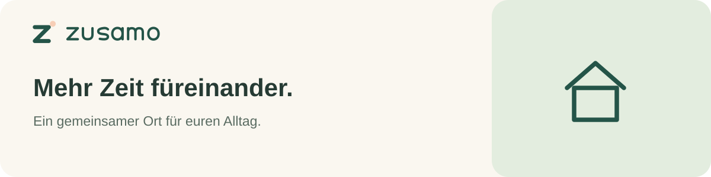

## Ein Zuhause für euren gemeinsamen Alltag.

Zusamo verbindet Termine, Aufgaben, Einkaufslisten, Kontakte und Rezepte an einem Ort. Für Familien, die weniger organisieren und mehr Zeit miteinander verbringen möchten – auf dem eigenen Heimatserver, im Browser und unterwegs.

### Was euch im Alltag hilft

| Bereich | Dafür ist er da |
| --- | --- |
| Kalender | Gemeinsame Termine und Einladungen im Blick behalten. |
| Aufgaben & Einkauf | Aufgaben verteilen und beim Einkauf an alles denken. |
| Kontakte | Menschen verbinden und die Herkunft ihrer Kontaktdaten bewahren. |
| Rezepte | Lieblingsgerichte sammeln und Zutaten auf die Einkaufsliste übernehmen. |
| Post & Einladungen | Aus Nachrichten nachvollziehbare nächste Schritte machen. |
| Google & Microsoft | Ausgewählte Dienste bewusst mit Zusamo verbinden. |
| Hermes | Vorschläge vorbereiten – Entscheidungen und Freigaben bleiben bei euch. |

### Gemeinsam, mit klaren Grenzen

- **Euer Zuhause für Daten:** ein eigener Heimatserver und getrennte Familien bzw. Arbeitsbereiche.
- **Modular aufgebaut:** ein gemeinsamer Kern und Helfer für konkrete Aufgaben.
- **Bewusste Freigaben:** Anmeldungen, Anbieterzugriffe und gemeinsame Inhalte werden getrennt behandelt.
- **Web und Mobile:** eine gemeinsame Oberfläche; Android und iPhone ergänzen native Gerätefunktionen.

### Für einen verlässlichen Kern

Zusamo entwickelt einen API-first-Kern mit dokumentierten Schnittstellen, einer zentralen Benutzeridentität und einem Berechtigungsmodell pro Arbeitsbereich. PostgreSQL Row Level Security wird schrittweise als Datenzugriffsgrenze umgesetzt. Die Architektur trennt Kern, isolierte Plugin-Oberflächen und optionale Verbindungsdienste.

### Aktueller Stand

**Zusamo ist ein Alpha-Projekt in aktiver Entwicklung.** Die Quellcode-Repositories sind derzeit privat. Eine öffentliche Freigabe, Store-Veröffentlichungen und produktive Betriebszusagen stehen noch aus. Anbieteranmeldungen, native Gerätefunktionen und der vollständige RLS-Umbau benötigen weitere Abnahme. Diese Seite stellt die Idee vor; sie ist kein Versprechen einer bereits produktionsreifen Lösung.

---

**Warm gestaltet. Gemeinsam gedacht.** Zusamo · Mehr Zeit füreinander.
